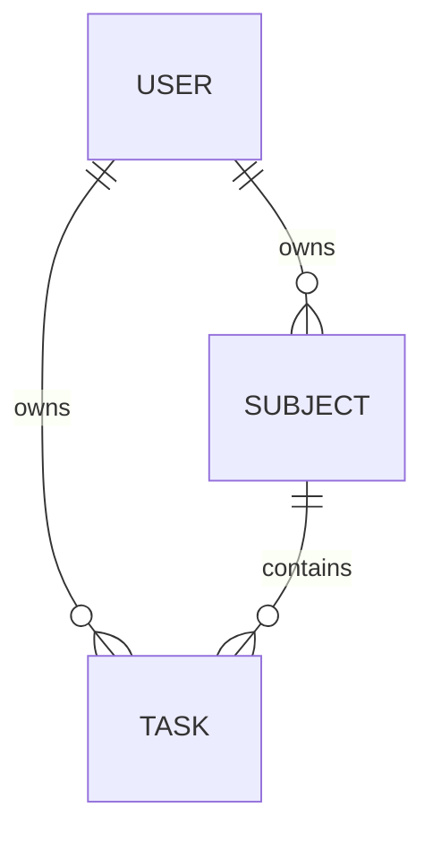

# База данных

PostgreSQL, схема `public`, ORM Prisma. Имена таблиц и столбцов в SQL заключаются в двойные кавычки, поскольку содержат заглавные буквы. Все поля обязательны, кроме `Task.completedAt`. Время хранится как `timestamptz(3)`, отображается в локальном часовом поясе браузера.

## User

| Поле         | SQL / Prisma тип          | Назначение и ограничения                                             |
| ------------ | ------------------------- | -------------------------------------------------------------------- |
| id           | serial / Int              | Первичный ключ, автоинкремент                                        |
| username     | varchar(80) / String      | Имя для интерфейса, API: 1–80 символов после trim                    |
| email        | varchar(254) / String     | Уникальный email; API проверяет формат и приводит к нижнему регистру |
| passwordHash | varchar(255) / String     | Только bcrypt-хэш с cost 12; в ответах API отсутствует               |
| createdAt    | timestamptz(3) / DateTime | Дата регистрации, DEFAULT CURRENT_TIMESTAMP                          |

Пароль вводится длиной от 8 символов, не более 72 байт UTF-8 из-за ограничения bcrypt; исходный пароль в БД не хранится.

## Subject

| Поле      | SQL / Prisma тип          | Назначение и ограничения                                  |
| --------- | ------------------------- | --------------------------------------------------------- |
| id        | serial / Int              | Первичный ключ, автоинкремент                             |
| userId    | integer / Int             | FK → User.id, владелец, ON DELETE CASCADE                 |
| name      | varchar(120) / String     | Название; 1–120 символов в API; уникально вместе с userId |
| teacher   | varchar(120) / String     | Преподаватель, по умолчанию пустая строка                 |
| color     | varchar(7) / String       | Цвет; API проверяет #RRGGBB; DEFAULT #6366f1              |
| createdAt | timestamptz(3) / DateTime | Дата создания, DEFAULT CURRENT_TIMESTAMP                  |

UNIQUE `(userId, name)` запрещает дубликаты названий внутри одного пользователя. Сравнение названий регистрозависимое. UNIQUE `(id, userId)` нужен для составного внешнего ключа из Task.

## Task

| Поле             | SQL / Prisma тип                     | Назначение и ограничения                                                 |
| ---------------- | ------------------------------------ | ------------------------------------------------------------------------ |
| id               | serial / Int                         | Первичный ключ, автоинкремент                                            |
| userId           | integer / Int                        | FK → User.id, владелец, ON DELETE CASCADE                                |
| subjectId        | integer / Int                        | Предмет; составной FK `(subjectId,userId)` → Subject `(id,userId)`       |
| title            | varchar(200) / String                | Заголовок, API: 1–200 символов после trim                                |
| description      | text / String                        | Описание, DEFAULT пустая строка, API максимум 10000 символов             |
| taskType         | TaskType / enum                      | homework, laboratory, practice, coursework, exam, other                  |
| deadline         | timestamptz(3) / DateTime            | Срок, API принимает ISO 8601 с часовым поясом; прошедшие сроки разрешены |
| importance       | integer / Int                        | Важность 1–3, DEFAULT 2, CHECK и серверная валидация                     |
| difficulty       | integer / Int                        | Сложность 1–3, DEFAULT 2, CHECK и серверная валидация                    |
| estimatedMinutes | integer / Int                        | Оценка времени: 1–525600 минут; CHECK и API                              |
| status           | TaskStatus / enum                    | planned, in_progress, completed; DEFAULT planned                         |
| createdAt        | timestamptz(3) / DateTime            | Создание, DEFAULT CURRENT_TIMESTAMP                                      |
| updatedAt        | timestamptz(3) / DateTime            | Prisma автоматически обновляет при записи через ORM                      |
| completedAt      | timestamptz(3), nullable / DateTime? | Серверное время завершения; NULL у незавершённых                         |

CHECK связывает status и completedAt: у `completed` дата обязательна, у остальных должна быть NULL. При повторном завершении API сохраняет первоначальную дату. При возвращении задачи в работу дата очищается.

## Связи и удаление

- User 1:N Subject.
- User 1:N Task.
- Subject 1:N Task.

Составной FK не позволяет связать задачу с чужим предметом, даже при прямой ошибочной записи через ORM. Удаление предмета с задачами запрещено (`RESTRICT`); сначала нужно перенести или удалить задачи. Endpoint удаления пользователя отсутствует. При ручной административной очистке сначала удаляют задачи, затем предметы, затем пользователя в транзакции.

## Индексы

- User.email — UNIQUE для входа и исключения повторной регистрации.
- Subject.(userId, name) — UNIQUE; используется при загрузке предметов владельца.
- Subject.(id, userId) — UNIQUE для составной связи.
- Task.(userId, deadline) — списки и ближайшие сроки.
- Task.(userId, status) — выборки статусов пользователя.
- Task.(subjectId, userId) — связь и выборки задач предмета.

## Вычисляемые данные

`priorityScore`, `priorityReason`, `overdue` и статистика не хранятся. Они вычисляются из текущих данных и времени при запросе. Просрочена только незавершённая задача с `deadline < now`. Дедлайн, равный now, ещё не просрочен. Dashboard и статистика читают задачи и предметы в одной транзакции RepeatableRead.

## Миграции

`20260922150323_init` создаёт таблицы, enum, индексы и связи.
`20260922152000_task_checks` добавляет ограничения чисел и согласованности completedAt.
CHECK-ограничения находятся в SQL-миграции: Prisma schema не описывает их напрямую. Применять нужно все миграции, а не только `db push`.
